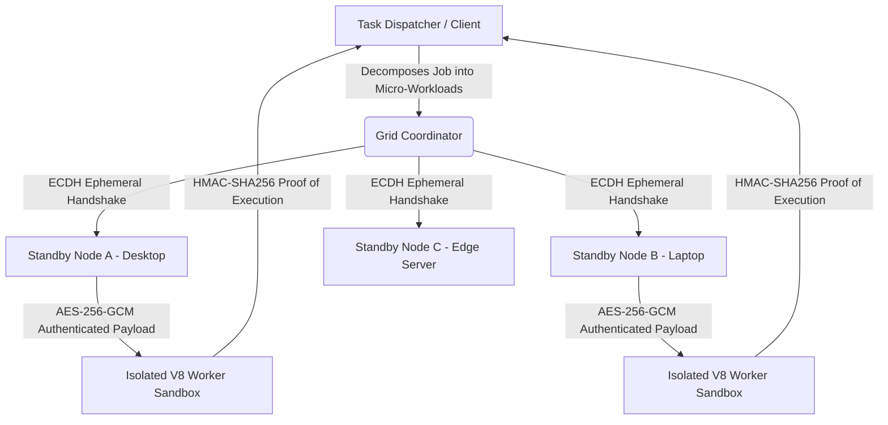

# 🌐 Open-Side: Decentralized Standby Compute Grid

[](https://opensource.org/licenses/MIT)
[](https://nodejs.org/)
[]()
[]()

**Open-Side** is a decentralized peer-to-peer compute grid that pools global idle hardware. By aggregating standby consumer devices into a zero-trust, encrypted mesh network, Open-Side distributes compute workloads securely without relying on centralized data centers.

---

## 🧠 System Architecture



### Core Architecture
1. **Dynamic Task Decomposition (`src/router.js`)**: Workloads are broken down into deterministic micro-shards and scheduled across nodes based on latency and idle telemetry.
2. **End-to-End Cryptography (`src/crypto.js`)**: Ephemeral Elliptic Curve Diffie-Hellman (ECDH) key exchanges and AES-256-GCM encryption prevent payload tampering.
3. **Telemetry-Gated Execution Sandbox (`src/sandbox.js`)**: Tasks run strictly inside isolated memory contexts and pause if the host device leaves standby mode.

---

## 🚀 Quick Start

### 1. Run Local Node
```bash
git clone [https://github.com/pc1209920-coder/Open-Side.git](https://github.com/pc1209920-coder/Open-Side.git)
cd Open-Side
npm start
```

### 2. Run Test Suite
```bash
npm test
```

## 📜 License
MIT License © 2026 Pratyush Chaudhary
