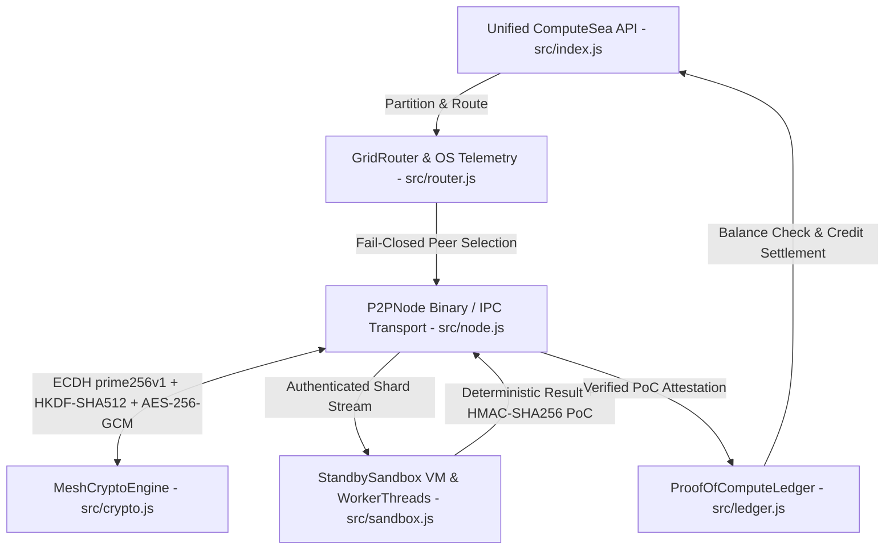

# 🌐 Open-Side: Single Compute Sea Protocol

[](https://opensource.org/licenses/MIT)
[](https://nodejs.org/)
[]()
[]()
[](./ROADMAP.md)
[]()

**Open-Side** implements the **Single Compute Sea** universal protocol standard: a hardware-agnostic, zero-dependency decentralized peer-to-peer (P2P) compute backbone that pools idle standby hardware into a zero-trust, encrypted execution mesh built exclusively on native Node.js core APIs (`node:crypto`, `node:vm`, `node:worker_threads`, `node:net`, `node:os`, `node:events`, `node:v8`, `node:http`, `node:test`, `node:assert`).

👉 **[View the Full Protocol Roadmap (ROADMAP.md)](./ROADMAP.md)**

---

## 🧠 Single Compute Sea Architecture



### Core Protocol Modules

1. **Cryptographic Engine & Anti-Replay Wire Protocol (`src/crypto.js` — `MeshCryptoEngine`)**
   - **Ephemeral Identity & Key Exchange**: Generates fresh `prime256v1` ECDH keypairs (130-character uncompressed hex `publicKey`) and derives a deterministic 40-character SHA-256 hex `nodeId`.
   - **RFC 5869 HKDF-SHA512 Session Key Rotation**: `deriveSessionKey()` derives symmetric session keys via `crypto.hkdfSync('sha512', ...)` with per-epoch `salt` / `epoch` isolation, domain-separated `info` binding (preserving arbitrary-length `info` entropy beyond OpenSSL's 1024-byte cap via SHA-512 compression), and key lengths up to 16,320 bytes (`255 * 64`), alongside baseline-compatible `deriveSharedKey()`.
   - **Authenticated AES-256-GCM**: `encryptShard()` and `decryptShard()` use fresh 12-byte random IVs, 16-byte authentication tags, optional Additional Authenticated Data (`aad`) wire header binding, monotonic `outboundNonce` counters guarded at `Number.MAX_SAFE_INTEGER`, and prototype-safe JSON payload parsing.
   - **Anti-Replay Sliding Window & Drift Guards**: `validateWirePacket()` and auth-validated `decryptShard(..., { validateReplay: true })` enforce `±60,000 ms` timestamp drift bounds (`maxTimeDriftMs`) and per-peer sequence tracking using either an RFC 6479 sliding window (`slidingWindowSize = 64`) or strict monotonic mode (`allowOutOfOrder: false`). Replay state commits **only** after GCM tag authentication succeeds.
   - **Proof-of-Compute Attestation**: Deterministic HMAC-SHA256 signing (`signProofOfCompute`) and constant-time `crypto.timingSafeEqual` verification (`verifyProofOfCompute`).

2. **Hardware Telemetry, Routing & Fail-Closed Load-Shedding (`src/router.js` — `GridRouter`, `QueueFullError`)**
   - **OS-Level Multi-Core Telemetry**: `getHardwareTelemetry()` computes real-time CPU load deltas across `os.cpus()` cores (`user`, `nice`, `sys`, `idle`, `irq`) using `BigInt` tick arithmetic (handling cross-platform field differences, zero-delta samples, and negative tick deltas) together with `os.freemem()` / `os.totalmem()` headroom tracking.
   - **Strict Fail-Closed Gating & Hysteresis**: Rejects or sheds compute whenever host CPU exceeds **25%** (`maxCpuThreshold = 0.25`), free memory drops below **10%** (`minFreeMemRatio = 0.10`, plus optional `minFreeMemBytes`), or telemetry reads fail (`TELEMETRY_INVALID`). Uses Schmitt-trigger hysteresis (`cpuHysteresisMargin = 0.03`, `cpuRecoveryStreakRequired = 2`) and emits `loadShed` / `telemetryRecovered` events across explicit states (`NOMINAL`, `CPU_OVERLOAD`, `MEMORY_EXHAUSTED`, `CPU_AND_MEMORY_EXHAUSTED`, `TELEMETRY_INVALID`).
   - **Fail-Closed Scheduling, Queueing & Aggregation**: `selectOptimalNodes()` ranks eligible standby peers by latency, capacity score, and deterministic SHA-256 tie-breaking (returning `[]` fail-closed when no peers qualify). Unassigned shards enter a bounded FIFO queue (`maxQueueSize = 1000`, throwing `QueueFullError` on overflow, with `maxQueueTimeMs = 60000` TTL pruning), disconnected peer work is rescheduled with bounded retries (`maxRetries = 3`), workloads are partitioned deterministically (`createTaskPartitions`), and outputs are reassembled in partition order (`aggregateResults`).

3. **Hardened Zero-Trust Execution Sandbox (`src/sandbox.js` — `StandbySandbox`)**
   - **Zero-Privilege V8 VM Boundary**: Executes synchronous shards inside isolated `node:vm` contexts with null-prototype dictionaries, frozen built-in primitives, and no host access (`fs`, `net`, `child_process`, `process`, `require`).
   - **Worker Thread Memory Caps & Timeouts**: Isolates asynchronous execution in `node:worker_threads` with strict `resourceLimits` (capping V8 heap growth so OOM is trapped safely without crashing the host) and millisecond execution timeout guards against infinite loops.
   - **AST / Static Token Pre-Validation & Escape Normalization**: Normalizes escape sequences (`\u00xx`, `\x00`, etc.) and statically rejects forbidden identifiers (`process`, `require`, `import`, `eval`, `Function`, `__proto__`, `constructor`, `prototype`) prior to execution.
   - **Deterministic State Virtualization**: Deep-freezes input payloads and virtualizes non-deterministic primitives so identical code and inputs yield reproducible results across heterogeneous nodes.

4. **Native P2P Transport Layer (`src/node.js` — `P2PNode`, `FrameTooLargeError`, `HandshakeTimeoutError`, `SocketDestroyedError`)**
   - **Zero-Dependency `node:net` Daemon**: Supports configurable TCP host/port binding (defaulting to ephemeral `127.0.0.1:0` loopback ports) with automatic local IPC named-pipe (`\\.\pipe\openside-...`) / Unix domain socket fallback on `EACCES`/`EPERM`.
   - **Binary Length-Prefixed Wire Framing**: `P2PNode.encodeFrame()` frames JSON messages with a 4-byte big-endian unsigned length prefix, handling TCP chunk fragmentation, coalesced frames, and oversized frame rejection fail-closed (`maxFrameSize` default 16 MB, throwing `FrameTooLargeError`).
   - **Live Encrypted Sessions**: Orchestrates two-way ephemeral ECDH handshakes (with `handshakeTimeoutMs` enforcement and handshake replay tracking), HKDF-SHA512 session key establishment and rotation, AES-256-GCM encrypted shard streaming, and signed Proof-of-Compute result delivery.

5. **Anti-Replay Proof-of-Compute Economic Ledger (`src/ledger.js` — `ProofOfComputeLedger`, `DoubleSpendAttemptError`, `InsufficientCreditBalanceError`)**
   - **Deterministic Micro-Credit Metering**: `calculateCredit()` meters execution duration (`baseRatePerMs = 0.1`, capped at `maxExecutionMs = 1500`), payload size (`byteWeight = 0.05`, capped at `maxInputSize = 10_000_000`), and `minCost = 1` using exact `BigInt` micro-credit fixed-point arithmetic (`1e-6` precision, overflow-guarded at `Number.MAX_SAFE_INTEGER`).
   - **Double-Spend & Replay Prevention**: `verifyAndSettle()` verifies HMAC-SHA256 Proof-of-Compute signatures in constant time and records settled attestation hashes (`settledAttestations`) and worker nonces (`usedNonces`), throwing `DoubleSpendAttemptError` on duplicate or cross-requester replay claims.
   - **Fail-Closed Balance Enforcement, Escrow & Audit Log**: Enforces pre-dispatch balance gating (`checkCreditAvailable()`, `canAfford()`, `reserveEscrow()`, `releaseEscrow()`), prevents negative balances and self-settlement by default, conserves total ledger balance (`getTotalBalance()`), maintains a SHA-256 hash-chained immutable audit log (`verifyAuditLog()`), and supports state snapshots (`exportState()`, `fromState()`).

6. **Unified Orchestration API & Simulation (`src/index.js` — `ComputeSea`, `OpenSideProtocol`, `OpenSideGateway`)**
   - Exposes `ComputeSea` (aliased as `OpenSideProtocol`) with `getCapabilities()`, `start()`, `addLocalWorker()`, `registerPeer()`, `rotateSessionKeys()`, `attachLedger()`, `fundAccount()`, `submitWorkload()`, `getWorkloadStatus()`, `cancelWorkload()`, and `close()`, integrating cryptography, telemetry-gated routing, P2P wire transport, sandboxed execution, and economic settlement alongside local simulation entrypoints.

7. **Drop-in AI/Agent HTTP Gateway (`src/gateway.js` — `OpenSideGateway`)**
   - OpenAI and Anthropic-compatible local HTTP gateway server (port 8080 or IPC named pipe) routing requests directly into the Compute Sea mesh.
   - Implements `POST /v1/chat/completions` (chat inference routing & execution tracking), `POST /v1/embeddings` (distributed embedding vector generation), `GET /v1/models`, and `GET /health` with optional Bearer token auth (`apiKey`).

8. **Periodic Checkpoint & State Resumption (`src/checkpoint.js` — `CheckpointManager`)**
   - Implements structured state serialization via native `node:v8` with automatic SHA-256 integrity digests over monotonic sequence indices.
   - Automatically handles periodic snapshotting, LRU eviction of old checkpoints, and fail-closed state restoration for interrupted or failed shards.
   - Seamlessly integrated with `GridRouter` to resume in-flight work when peers fail or disconnect.

9. **P2P Auto-Discovery & Kademlia DHT (`src/dht.js` — `KademliaDHT`, `RoutingTable`, `KBucket`)**
   - Implements a 160-bit XOR distance metric across 20-byte Node IDs, satisfying symmetry and the triangle inequality.
   - Features 160 $k$-buckets ($k=20$, $\alpha=3$) with LRU eviction and duplicate updates.
   - Provides distributed key-value storage (`PING`, `STORE`, `FIND_NODE`, `FIND_VALUE`), iterative lookup, and automatic network bootstrapping.

10. **WASM Runtime Engine (`src/wasm.js` — `WasmEngine`)**
    - High-performance, sandboxed WebAssembly execution with strict capability sandboxing (no ambient OS access).
    - Hard memory bounding via `WebAssembly.Memory` page limits and millisecond execution timeout guards.
    - Zero-dependency synthetic WASM generation for deterministic micro-benchmarking and test verification.

11. **Headless Daemon & Cluster Orchestrator (`src/daemon.js` — `DaemonMaster`)**
    - Production-grade OS daemon with atomic PID file tracking, rotating log streams, and OS service signal handling (`SIGTERM`/`SIGINT`).
    - Native `node:cluster` multi-process orchestrator unlocking 100% multi-core CPU task parallelism with automatic worker self-healing.

---

## 📁 Repository Layout

```text
Open-Side/
├── .github/
│   └── workflows/ci.yml       # Syntax checks (all modules), tests, simulation
├── ROADMAP.md                 # Full protocol development roadmap
├── src/
│   ├── index.js               # Unified ComputeSea API & simulation entrypoint
│   ├── crypto.js              # ECDH prime256v1, HKDF-SHA512, AES-256-GCM, anti-replay, HMAC PoC
│   ├── router.js              # OS telemetry deltas, 25% CPU / 10% mem load-shedding, queue & routing
│   ├── sandbox.js             # Elastic standby worker pool, AST pre-validation, VM sandbox
│   ├── node.js                # Native node:net P2P transport, v8 binary framing & IPC fallback
│   ├── ledger.js              # Anti-replay Proof-of-Compute economic credit ledger
│   ├── gateway.js             # Drop-in AI/Agent HTTP Gateway on port 8080
│   ├── checkpoint.js          # Checkpoint & state resumption engine with SHA-256 integrity
│   ├── dht.js                 # P2P auto-discovery & Kademlia distributed hash table
│   ├── wasm.js                # Sandboxed WebAssembly compute engine
│   ├── daemon.js              # Multi-process cluster orchestrator & headless daemon
│   └── transport/
│       └── websocket.js       # Native RFC 6455 WebSocket transport client & server
├── test/
│   ├── mesh.test.js           # Core protocol invariants, cryptography, telemetry & routing tests
│   ├── m4_sandbox.test.js     # Sandbox isolation, AST validation, OOM & determinism tests
│   ├── m5_node.test.js        # Live P2P loopback/IPC transport & wire framing tests
│   ├── m6_ledger_e2e.test.js  # Economic ledger & full end-to-end ComputeSea tests
│   ├── milestone2.test.js     # WebSocket transport, 5s heartbeat/15s dead-peer & graceful teardown tests
│   ├── milestone3.test.js     # Multi-core cluster & daemon test suite
│   ├── phase1_refinements.test.js # Audited phase 1 regression tests
│   ├── phase2_features.test.js    # Elastic pool, v8 wire protocol & AI gateway tests
│   ├── checkpoint.test.js     # Checkpoint serialization, verification & router integration tests
│   ├── dht.test.js            # XOR distance metric, k-buckets & distributed network tests
│   └── wasm.test.js           # WebAssembly memory bounds, execution & timeout tests
├── package.json               # CommonJS, zero external dependencies
├── README.md
└── SECURITY.md
```

---

## 🚀 Quick Start & Verification

### 1. Run Local Simulation
```bash
git clone https://github.com/pc1209920-coder/Open-Side.git
cd Open-Side
npm start
```

### 2. Run Full Test Suite
`package.json` uses the native Node.js test runner (`node --test`) with zero external dependencies:
```bash
npm test
# or directly:
node --test
```

### 3. Syntax Validation Across All Modules
Each module must be checked individually with `node --check` (Node validates only the first script argument per `--check` invocation):
```bash
node --check src/index.js
node --check src/crypto.js
node --check src/sandbox.js
node --check src/router.js
node --check src/node.js
node --check src/ledger.js
node --check src/gateway.js
```

---

## 📜 License
MIT License © 2026 Pratyush Chaudhary

