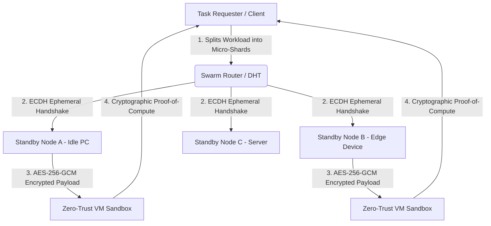

# 🌐 Open-Side: Decentralized P2P Standby Compute Protocol

[](https://opensource.org/licenses/MIT)
[](https://nodejs.org/)
[]()
[]()

**Open-Side** is a BitTorrent-inspired, encrypted peer-to-peer (P2P) compute and resource-sharing protocol. It connects idle, standby edge devices into a global decentralized mesh network, allowing them to securely pool compute power and execute sandboxed workloads—drastically reducing developer reliance on centralized hyperscale data centers.

---

## 🧠 System Architecture

Open-Side adapts the **BitTorrent Kademlia DHT** and **Tit-for-Tat Swarm** mechanics from static file sharing to **dynamic, encrypted compute execution**:



### Core Pillars
1. **BitTorrent-Inspired Compute Swarm (`src/router.js`)**: Tasks are sharded into deterministic micro-workloads and distributed across idle peers based on real-time latency, battery/power state, and CPU availability.
2. **End-to-End Cryptographic Mesh (`src/crypto.js`)**: Every peer-to-peer connection negotiates an ephemeral **Elliptic Curve Diffie-Hellman (ECDH)** shared secret, encrypting all task shards with **AES-256-GCM** and verifying integrity via SHA-256 HMACs.
3. **Zero-Trust Standby Sandbox (`src/sandbox.js`)**: Standby nodes only execute incoming workloads when system telemetry confirms idle status. Tasks run inside a strictly isolated V8 virtual machine context with zero filesystem or network escalation privileges.

---

## 📂 Repository Structure

```text
Open-Side/
├── package.json          # Protocol metadata, scripts, and engine definitions
├── README.md             # Architecture documentation and setup guide
├── LICENSE               # MIT Open Source License
└── src/
    ├── index.js          # Main P2P Daemon & Standby Node Orchestrator
    ├── router.js         # Kademlia DHT Swarm Router & Load Balancer
    ├── crypto.js         # ECDH Handshake & AES-256-GCM Encrypted Tunneling
    └── sandbox.js        # Zero-Trust Isolated VM Execution Engine
```

---

## 🚀 Quick Start

### 1. Clone & Initialize Node
```bash
git clone [https://github.com/pc1209920-coder/Open-Side.git](https://github.com/pc1209920-coder/Open-Side.git)
cd Open-Side
npm start
```

### 2. Run Cryptographic & Swarm Diagnostics
```bash
npm test
```

---

## 🛡️ Security & Vulnerability Auditing
Because Open-Side executes distributed workloads across untrusted standby devices, strict cryptographic verification and sandbox containment are critical. All PRs touching `src/crypto.js` or `src/sandbox.js` undergo automated static analysis and regression testing before merge.

## 📜 License
Released under the **MIT License**. Built for an open, decentralized compute future.
