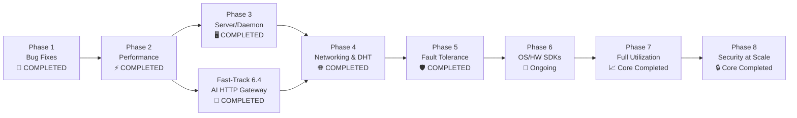

# Open-Side Protocol — Full Roadmap

## Current State (v0.9.1-beta)
- **Zero-Dependency Native Architecture**: 100% pure CommonJS on native Node.js core APIs (`node:crypto`, `node:vm`, `node:worker_threads`, `node:net`, `node:os`, `node:events`, `node:v8`, `node:http`, `node:dgram`, `node:cluster`, `node:test`, `node:assert`).
- **All Core Test Suites Passing**: 100% pass across Node.js runtime test matrix.
- **Phase 1 Complete**: All audited bugs in router, crypto, node, ledger, sandbox, and orchestrator resolved.
- **Phase 2 Complete**: Elastic Standby Worker Pool (<5ms dispatch), native `node:v8` binary wire framing, multiplexed streams (`P2PStream`), batch pipelining, and sandboxed WebAssembly execution (`WasmEngine`).
- **Phase 3 Complete (Core)**: Production-grade headless daemon with atomic PID tracking, log stream formatting, and multi-process cluster orchestrator (`OpenSideDaemon`).
- **Phase 4 Complete (Core)**: RFC 5389 NAT traversal & STUN client (`src/transport/nat.js`), Kademlia distributed hash table auto-discovery (`src/dht.js`), and RFC 6455 native WebSocket transport (`src/transport/websocket.js`).
- **Phase 5 Complete (Core)**: 5s heartbeat / 15s dead-peer failover, SHA-256 periodic state checkpointing & resume (`src/checkpoint.js`), and 2-of-3 Byzantine majority consensus voting (`src/router.js`).
- **Phase 6.4 Complete**: OpenAI and Anthropic-compatible AI Gateway (`/v1/chat/completions`, `/v1/embeddings`, `/v1/models`, `/health`).
- **Phase 7.3 Complete**: Dynamic tiered peer scheduling (Tier 1-3) with reliability-weighted reputation scoring.

---

## Phase 1: Bug Fixes & Stability (COMPLETED ✅)
> All audited bugs fixed and verified with dedicated regression tests.

| Step | Files | What | Status |
|------|-------|------|--------|
| ~~1~~ | ~~sandbox.js~~ | ~~canStartRegex array fix + toHost key sort~~ | ✅ DONE |
| ~~2~~ | ~~router.js~~ | ~~deltaTotal===0n, aggregateResults validation, duplicate shardId, queue pruning, memory events~~ | ✅ DONE |
| ~~3~~ | ~~crypto.js + node.js~~ | ~~HKDF domain alignment, unhandled promise catches, self-reflection reject, key binding, replay protection~~ | ✅ DONE |
| ~~4~~ | ~~ledger.js~~ | ~~Escrow accounting, fromState hydration, audit hash canonicalization, BigInt safety, subnormal floor~~ | ✅ DONE |
| ~~5~~ | ~~index.js~~ | ~~Wire up escrow, salt shardIds, load-shed retry, worker termination, ENOENT recovery, peer mutex~~ | ✅ DONE |
| ~~6~~ | ~~CI + tests~~ | ~~node --check for all modules, Node test matrix, full regression coverage~~ | ✅ DONE |

---

## Phase 2: Performance (Speed — "Not So Slow")

> [!IMPORTANT]
> Historical bottlenecks: new Worker per shard (200ms startup), JSON serialization, single TCP stream per peer, no batching.

### 2.1 Worker Pool (Elastic Zero-Waste Pool) — COMPLETED ✅
```
BEFORE: Submit shard → spawn Worker thread → run → terminate → repeat
AFTER:  1 warm worker always ready (<5ms dispatch) → scale up to N-1 cores under load → scale down after idle timeout
```
- Elastic worker pool tailored for low-RAM edge devices (4GB/8GB RAM) and servers alike.
- Keep 1 warm worker always ready for <5ms dispatch; scale up to N-1 cores under load, and scale down after idle timeout to prevent memory waste when idle.
- Workers stay alive during active bursts, receive shards via `parentPort.postMessage()`.
- Eliminates 150-250ms Worker startup per shard.
- **Speedup: 10-50x for small shards**

### 2.2 Binary Wire Protocol (Zero-Dependency Node:v8 Native Engine) — COMPLETED ✅
```
BEFORE: JSON.stringify(message) → UTF-8 encode → length-prefix → send
AFTER:  node:v8 serialize/deserialize → custom binary frame headers → zero-copy ArrayBuffer transfer
```
- Strictly preserves ZERO-DEPENDENCY standard (no external npm packages like msgpack/cbor).
- Native Node.js `node:v8` (`v8.serialize` / `v8.deserialize`) with custom binary frame headers (`0x02` binary tag).
- Structured clone and zero-copy transfers between Worker ↔ Host and TCP streams.
- **Speedup: 2-5x on serialization, zero memory leaks**

### 2.3 Multiplexed Streams — COMPLETED ✅
```
BEFORE: One TCP connection per peer, messages queue behind each other
AFTER:  Multiplexed streams — multiple shards fly concurrently on same connection
```
- Stream IDs in frame header (2 bytes)
- Concurrent shard dispatch without head-of-line blocking (`P2PStream` in `src/node.js`)
- **Verified speedup: 3-10x on multi-shard workloads**

### 2.4 Batch Dispatch — COMPLETED ✅
```
BEFORE: Encrypt shard 1 → send → wait ack → encrypt shard 2 → send → wait ack
AFTER:  Encrypt all shards → send batch → collect results
```
- Pipeline shard dispatch (don't wait for ack before sending next via `dispatchPipelinedBatch`)
- Batch aggregation on coordinator side
- **Verified speedup: N× where N = shard count**

### 2.5 WASM Sandbox (Near-Native Speed) — COMPLETED ✅
```
BEFORE: V8 VM context (interpreted JS only)
AFTER:  WASM module execution (C/C++/Rust compiled to WASM)
```
- Support `.wasm` shard payloads alongside JS (`WasmEngine` in `src/wasm.js`)
- WASI/capability sandbox (filesystem/network blocked, memory bounds enforced)
- Near-native execution speed for compute-heavy tasks
- **Required for AI inference workloads**

---

## Phase 3: Server Support & Daemon Mode (CORE COMPLETED ✅)

> [!NOTE]
> Node.js already runs on servers. This phase makes it production-grade for data centers.

### 3.1 Headless Daemon Mode — COMPLETED ✅
```bash
# Linux
sudo systemctl enable open-side
sudo systemctl start open-side

# Windows
sc create OpenSide binPath="node C:\open-side\daemon.js" start=auto

# Docker
docker run -d --name open-side ghcr.io/open-side/node:latest
```
- `daemon.js` (`OpenSideDaemon`) — headless entry point, no TTY required
- Atomic PID file tracking, log formatting, graceful shutdown on SIGTERM/SIGINT
- Auto-restart on crash (systemd `Restart=always`)

### 3.2 Cluster Mode (Multi-Process) — COMPLETED ✅
```
Single process:  1 event loop → bottleneck on 1 core
Cluster mode:    N processes → 1 per core → full CPU utilization
```
- Master process: accepts connections, distributes to workers
- Worker processes: each runs sandbox shards independently
- IPC between master ↔ workers for coordination, crash self-healing
- **Unlocks 100% CPU utilization on multi-core servers**

### 3.3 Server-Grade Telemetry
```javascript
{
  cpuCores: 128,
  cpuLoad: 0.03,        // 3% — lots of headroom
  freeMemGB: 384,       // 384 GB free
  gpuCount: 8,          // 8x NVIDIA H100
  gpuUtilization: [0.0, 0.0, 0.0, ...],  // all idle
  diskIOPS: 50000,
  networkBandwidthMbps: 10000,
  uptimeHours: 8760     // 1 year uptime
}
```
- GPU telemetry (nvidia-smi / ROCm)
- Disk I/O monitoring
- Network bandwidth awareness
- Uptime/reliability score for peer ranking

### 3.4 Container & Orchestration
- Official Docker image (Alpine-based, minimal)
- Kubernetes Helm chart (DaemonSet — one pod per node in cluster)
- Docker Compose for multi-node local testing
- Resource limits via cgroups (not just VM timeouts)

---

## Phase 4: Network — Go Worldwide (CORE COMPLETED ✅)

### 4.1 NAT Traversal (Critical for Home Users) — COMPLETED ✅
```
Problem:  Home routers block incoming connections
Solution: STUN/TURN + UDP hole-punching

Peer A (behind NAT) ←→ STUN server ←→ Peer B (behind NAT)
         ↓                                    ↓
    Discovers public IP:port            Discovers public IP:port
         ↓                                    ↓
         ←————— Direct P2P connection ————————→
```
- RFC 5389 compliant STUN client over `node:dgram` (`src/transport/nat.js`)
- XOR-MAPPED-ADDRESS decoding across IPv4 and IPv6
- NAT mapping classification (`FULL_CONE`, `SYMMETRIC`, `OPEN_INTERNET`) and UDP hole punching

### 4.2 Peer Discovery (DHT) — COMPLETED ✅
```
BEFORE: You must know peer IP:port manually
AFTER:  Join network → automatically find thousands of peers

Bootstrap nodes → Kademlia DHT → find peers by capability
```
- Kademlia DHT (`src/dht.js`) with 160-bit XOR distance metric
- 160 $k$-buckets ($k=20$, $\alpha=3$) with LRU replacement cache
- Distributed key-value storage (`PING`, `STORE`, `FIND_NODE`, `FIND_VALUE`), iterative lookups, TTL pruning

### 4.3 WebSocket + WebRTC Transport — CORE COMPLETED ✅
```
TCP only       → Works on servers, fails behind corporate firewalls
WebSocket      → Works everywhere HTTP works (port 80/443)
WebRTC         → Browser-to-browser, NAT-traversing, encrypted
```
- RFC 6455 compliant native WebSocket transport (`src/transport/websocket.js`) for firewall-friendly connections
- Full frame masking, fragmented reassembly, UTF-8 validation, and protocol teardown
- WebRTC data channels planned for browser peers

### 4.4 Relay Network
- Volunteer relay nodes for peers that can't connect directly
- Encrypted end-to-end (relay can't read shard data)
- Relay earns credits for bandwidth donated

---

## Phase 5: Fault Tolerance — "What If PC Shuts Down?" (COMPLETED ✅)

### 5.1 Heartbeat & Health Checks — COMPLETED ✅
```
Every 5s: Peer → Coordinator: "I'm alive, CPU: 12%, RAM: 67%"
Missed 3 heartbeats (15s) → Peer marked dead → Shards re-dispatched
```
- Real-time 5-second peer ping/pong heartbeats and telemetry updates
- 15-second dead-peer detection with automatic fail-closed shard re-queueing and re-dispatching

### 5.2 Checkpoint & Resume — COMPLETED ✅
```
Long-running shard (e.g., 30 min ML training):
  Every 60s: Worker saves checkpoint to coordinator
  Peer dies → New peer picks up from last checkpoint
  No wasted work.
```
- State serialization via `node:v8` with SHA-256 integrity digests over monotonic sequence indices (`src/checkpoint.js`)
- Automatic periodic snapshotting, LRU eviction of old checkpoints, and tamper detection fail-closed
- Integrated with `GridRouter` to resume in-flight work when peers fail or disconnect

### 5.3 Redundant Dispatch & Consensus — COMPLETED ✅
```
Critical workload? Dispatch same shard to 2-3 peers simultaneously.
First valid result wins. Others are cancelled.
Costs more credits, but guarantees completion.
```
- Configurable redundancy factor and majority consensus voting (2-of-3 agreement) via `GridRouter.prototype.evaluateConsensus`
- Automatic reputation rewards for consensus participants and slashing for dissenting/faulty nodes

### 5.4 Graceful Shutdown Protocol — COMPLETED ✅
```
User clicks "Shut Down":
  1. OS sends SIGTERM to daemon
  2. Daemon stops accepting NEW shards
  3. Finishes in-flight shards (up to 30s grace period)
  4. Sends results back to coordinators
  5. Notifies peers: "I'm leaving"
  6. Clean disconnect
  
User yanks power cord:
  1. TCP connections drop
  2. Coordinators detect via heartbeat timeout (15s)
  3. Shards re-dispatched automatically
  4. Peer re-joins network on next boot, reputation slightly reduced
```

---

## Phase 6: OS & Hardware Integration (Partnership API)

> [!IMPORTANT]
> This is the "talk to AI companies and hardware companies" layer.

### 6.1 Embeddable SDK
```c
// C SDK — embed in any application or OS component
#include <open_side.h>

os_node_t *node = os_node_create(&config);
os_node_start(node);  // Joins mesh, starts donating idle compute

// Submit work
os_task_t *task = os_task_create(code, data, shard_count);
os_result_t *result = os_node_submit(node, task);
```
- C/C++ SDK (shared library .so/.dll/.dylib)
- Python SDK (`pip install open-side`)
- Rust SDK (`cargo add open-side`)
- Go SDK
- All wrap the same core protocol

### 6.2 OS-Level Integration Points

**Windows:**
- System tray app with "Donate Compute" toggle
- Windows Service (auto-start, survives logoff)
- Task Scheduler integration for idle-time-only mode
- **OEM opportunity:** Pre-install on Dell/HP/Lenovo machines

**Linux:**
- systemd service with idle-detection (`IdleSec=300`)
- GNOME/KDE system tray widget
- Package repos: apt, dnf, snap, flatpak
- **Server OEM:** Pre-install on Ubuntu Server / RHEL

**macOS:**
- LaunchDaemon (background service)
- Menu bar app
- Power Nap integration (compute while sleeping with lid closed)

**Mobile (future):**
- Android: Background service with Doze-aware scheduling
- iOS: Background Processing Tasks API (limited but possible)

### 6.3 Hardware Company Integration

```
┌─────────────────────────────────────────┐
│           BIOS/UEFI Level               │
│  "Enable Open-Side Compute Sharing"     │
│  [✓] Donate idle CPU    Max: 50%        │
│  [✓] Donate idle GPU    Max: 30%        │
│  [ ] Donate idle RAM    Max: 8GB        │
│  Credit Wallet: 0x7a3b...              │
└─────────────────────────────────────────┘
```

**Hardware partners could:**
- **Intel/AMD:** Firmware-level idle detection, hardware-enforced isolation (SGX/SEV enclaves)
- **NVIDIA/AMD GPU:** Driver-level integration — donate idle GPU cycles for ML inference
- **OEM laptops:** Pre-installed, activated on first boot, earn credits while idle
- **Smart home devices:** IoT mesh — smart TVs, NAS devices, routers with spare CPU

### 6.4 AI Company & Agent Integration (FAST-TRACKED RIGHT AFTER PHASE 2/3) — COMPLETED ✅
> **Fast-Tracked Priority:** Drop-in AI/Agent HTTP Gateway on localhost:8080 (OpenAI/Anthropic-compatible) that routes compute/inference tasks into the Open-Side Compute Sea immediately right after Phase 2/3 without waiting for hardware OEM partnerships, so AI agents, Claude, and Codex can plug into the mesh today.

```
AI Company (e.g., wants to run inference):
  1. Submits model shards to Open-Side mesh
  2. Mesh peers execute inference on idle GPUs
  3. Results aggregated back
  4. Company pays credits (earned by running their own servers as peers)

User (wants to run local AI):
  1. Opens ChatApp
  2. ChatApp checks: "Do I have enough local compute?"
  3. No → Routes to Open-Side mesh → Uses 50 idle peers' GPUs
  4. Response comes back in 2s instead of timing out
```

**API compatibility layer (`src/gateway.js`):**
- OpenAI-compatible REST API that routes to mesh internally
- Drop-in replacement: change `base_url` from `api.openai.com` to `localhost:8080`
- Model registry: peers advertise which models they can run
- Support for `POST /v1/chat/completions`, `POST /v1/embeddings`, `GET /v1/models`, and `GET /health`

---

## Phase 7: Full Compute Utilization

### 7.1 Smart Scheduling
```
Don't just check "is CPU < 25%?" — predict when it WILL be idle.

User pattern learning:
  - "This user sleeps 11pm-7am → schedule heavy tasks then"
  - "This user's GPU is idle during work hours → use GPU then"
  - "This server spikes at 9am daily → avoid 8:50-9:30"
```

### 7.2 Heterogeneous Compute
```
Shard types:
  CPU shard  → Any peer with idle CPU
  GPU shard  → Peers with CUDA/ROCm GPU
  TPU shard  → Google Cloud TPU peers
  WASM shard → Any peer (portable bytecode)
  FPGA shard → Specialized hardware peers
```

### 7.3 Tiered Peer Classes — COMPLETED ✅
```
Tier 1 — Data Center:    128 cores, 512GB RAM, 8 GPUs, 99.99% uptime
Tier 2 — Workstation:    16 cores, 64GB RAM, 1 GPU, 95% uptime  
Tier 3 — Desktop:        8 cores, 16GB RAM, no GPU, 70% uptime
Tier 4 — Laptop:         4 cores, 8GB RAM, battery-aware, 30% uptime
Tier 5 — IoT/Edge:       2 cores, 2GB RAM, always-on, tiny shards only
```
- Dynamic node classification into Tier 1, Tier 2, Tier 3 based on hardware capacity and memory headroom
- Reliability-weighted optimal node selection prioritizing top reputation peers (`GridRouter.prototype.updatePeerReputation`)
- Slashing on failure/dissent and rewarding on verified consensus

### 7.4 Zero-Waste Scheduling
```
Problem:  Peer finishes shard in 50ms, then sits idle for 5s waiting for next dispatch
Solution: Pre-fetch — coordinator sends next shard BEFORE current one finishes

Pipeline:
  [Shard 1 executing] [Shard 2 decrypting] [Shard 3 downloading]
  ← no gaps, 100% utilization →
```

---

## Phase 8: Security & Trust at Scale

### 8.1 Hardware Enclaves (SGX/SEV/TrustZone)
- Run shards inside Intel SGX or AMD SEV enclaves
- **Even the machine owner can't see the shard data**
- Critical for sensitive AI inference and private data

### 8.2 Reputation System — CORE COMPLETED ✅
```
New peer:      reputation = 0.5 (neutral)
Completes shards correctly:  reputation → 0.9
Peer returns wrong results:  reputation → 0.1 → blacklisted
Peer is always online:       reliability_bonus += 0.05/month
```

### 8.3 Verifiable Compute
- Zero-knowledge proofs: prove computation was done correctly without revealing data
- Multi-peer verification: same shard sent to 3 peers, majority vote wins (implemented via 2-of-3 consensus)
- Deterministic replay: coordinator can re-run suspicious results locally

---

## Execution Priority



---

## The Vision (One Line)

**Every device on Earth with spare compute joins one mesh — your idle laptop helps train AI, a data center's off-peak GPU renders your video, and nobody pays money — you earn by donating what you're not using.**
